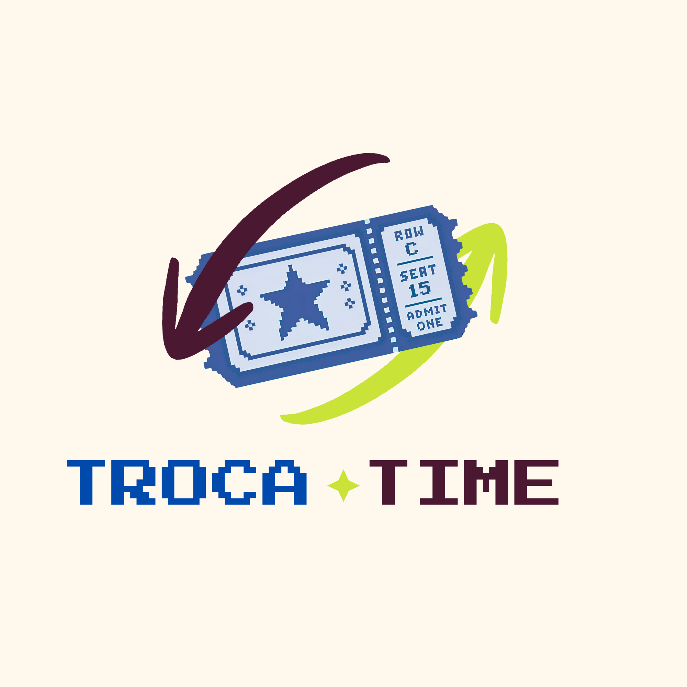

# FECAP - Fundação de Comércio Álvares Penteado

<p align="center">
<a href= "https://www.fecap.br/"></a>
</p>

# Troca Time

## Troca Time

## Integrantes: <a href="https://www.linkedin.com/in/giovannarbueno/">Giovanna Bueno</a>, <a href="">Olivia Farias</a>, <a href="https://www.linkedin.com/in/pedro-kimura-3a847243a/">Pedro Kimura</a>

## Professores Orientadores: <a href="https://www.linkedin.com/in/dolemes/">David de Oliveira Lemes</a>, <a href="https://www.linkedin.com/in/francisco-escobar/">Francisco Escobar</a>, <a href="https://www.linkedin.com/in/jesuslisboagomes/">Jesus Gomes</a>, <a href="https://www.linkedin.com/in/katia-bossi/">Kátia M. Lara Bossi</a>, <a href="https://www.linkedin.com/in/paula-astorino-432b5812a/">Paula Astorino</a>

## Descrição

<p align="center">

  Imagem de autoria do autor 
</p>
<br><br>
O projeto constitui em desenvolver uma plataforma Web para apoiar a TrocaTicket e os organizadores de eventos no
planejamento financeiro e operacional, possibilitando o cadastro de eventos e custos, a interação com
fornecedores por meio de propostas e o cálculo do valor estimado do ingresso a partir dos custos
consolidados, do público e da margem de lucro.
Isso será feito por meio de uma aplicação Web com
três módulos integrados: Administrador (TrocaTicket), Organizador e Fornecedor. O Organizador criará
eventos, cadastrará itens de composição de custo e parâmetros financeiros; os Fornecedores
visualizarão oportunidades e enviarão propostas; e o Administrador realizará aprovações,
acompanhamento e consultas gerenciais.<br>
O foco do MVP é criar um Web Site responsivo, intuitivo e que ajude no planejamento de eventos, obtenção e comparação de propostas para os organizadores, a consolidação dos custos e o cálculo do ticket médio estimado com base no público, nos custos e na margem de lucro definida.<br>


## 🛠 Estrutura de pastas

-Raiz<br>
|<br>
|-->documentos<br>
  &emsp;|--Entrega 1<br>
  &emsp;&emsp;|--Banco de Dados <br>
  &emsp;&emsp;|--Cálculo II <br>
  &emsp;&emsp;|--Full stack <br>
  &emsp;&emsp;|--Gestão Empresarial <br>
  &emsp;&emsp;|--PI <br>
  &emsp;|--Entrega 2<br>
  &emsp;&emsp;|--Banco de Dados <br>
  &emsp;&emsp;|--Cálculo II <br>
  &emsp;&emsp;|--Full stack <br>
  &emsp;&emsp;|--Gestão Empresarial <br>
  &emsp;&emsp;|--PI <br>
  &emsp;|Documentação.docx<br>
|-->imagens<br>
|-->src<br>
  &emsp;|--Entrega 1 <br>
  &emsp;&emsp;|-->Backend<br>
  &emsp;&emsp;|-->Frontend<br>
  &emsp;|--Entrega 2 <br>
  &emsp;&emsp;|-->Backend<br>
  &emsp;&emsp;|-->Frontend<br>
|readme.md<br>

## 📄​ Entregas
| Disciplina | Entrega 1 | Entrega 2 |
| :--- | :--- | :--- |
| **Banco de Dados** | [DER](<documentos/Entrega 1/Banco de Dados/DER - Entrega 1 - BD.pdf>) | [Tabelas do projeto](</Users/giovanna/Projeto7/documentos/Entrega 2/Banco de Dados/README.md>) | 
| **Cálculo II** | [Aplicação Teorema de Tylor](<documentos/Entrega 1/Cálculo II/Entrega1-CálculoII.docx.pdf>) | - |
| **Full Stack** | [Primeira parte do FrontEnd](<documentos/Entrega 1/Full Stack/troca-time>) | - |
| **Gestão Empresarial** | [Entrega Geral do grupo](<documentos/Entrega 1/Gestão Empresárial/TrocaTicket_Entrega1_Gestao_Empresarial.pdf>) <br>*(As entregas individuais encontram-se na mesma pasta)* | [Fluxo Empresarial](</Users/giovanna/Projeto7/documentos/Entrega 2/Gestão Empresarial/TrocaTicketFluxo.pdf>) e [Documentação do Fluxo](</Users/giovanna/Projeto7/documentos/Entrega 2/Gestão Empresarial/TrocaTicketFluxoDocs.pdf>) *(As entregas individuais encontram-se na mesma pasta)* |
| **PI** | [Figma do projeto](<documentos/Entrega 1/PI/ProjetoFigma.md>) | [Projeto de Extensão docx](</Users/giovanna/Projeto7/documentos/Entrega 2/PI/Projeto_de_Extensão_-_TrocaTicket.docx>) e [Projeto de Estensão pdf](</Users/giovanna/Projeto7/documentos/Entrega 2/PI/Projeto_de_Extensão_-_TrocaTicket.pdf>)|


## 🛠 Instalação

<b>HTML:</b>

O Troca-Time é uma aplicação web. Este projeto não inclui APK, executável `.exe` nem um endereço publicado para acesso.

Para usar a aplicação, é necessário executá-la localmente seguindo a seção **Configuração para Desenvolvimento** abaixo. Depois de iniciar o front-end, acesse no navegador o endereço informado pelo Vite, normalmente `http://localhost:5173/`.

Para acessar uma versão publicada, use o endereço fornecido pela equipe responsável pelo projeto.<br>

## 💻 Configuração para Desenvolvimento

### Requisitos

Instale:

- **Node.js e npm**, para executar o front-end e o back-end.
- **Git**, caso vá obter o projeto por um repositório.
- **Acesso a um banco MySQL** com a estrutura e os dados necessários para a aplicação.

### 1. Abra a pasta do projeto

No terminal, acesse a pasta onde o projeto está salvo:

```bash
cd caminho/para/troca-time
```

Substitua `caminho/para/troca-time` pelo caminho real da pasta.

### 2. Configure e inicie o back-end

O back-end está na pasta `server`. Crie o arquivo `server/.env` usando `server/.env.example` como referência. Para um banco local, o conteúdo pode seguir este modelo:

```ini
PORT=3000

DB_HOST=localhost
DB_PORT=3306
DB_USER=SEU_USUARIO_MYSQL
DB_PASSWORD=SUA_SENHA_MYSQL
DB_NAME=troca_time

JWT_SECRET=CRIE_UM_SEGREDO_PARA_DESENVOLVIMENTO
JWT_EXPIRES_IN=1d

CLIENT_URL=http://localhost:5173
```

Substitua os valores de exemplo pelos dados do seu ambiente. O banco `troca_time` e as tabelas necessárias precisam existir. O projeto não inclui um script SQL de criação das tabelas; solicite à equipe os arquivos ou as instruções de configuração do banco, se necessário.

Não compartilhe o arquivo `.env`, pois ele pode conter senhas e segredos.

No terminal:

```bash
cd server
npm install
npm run dev
```

Mantenha o terminal aberto. Com a configuração acima, o back-end ficará disponível em `http://localhost:3000`.

### 3. Configure e inicie o front-end

Abra um segundo terminal. Crie o arquivo `client/.env` com o endereço do back-end:

```ini
VITE_API_URL=http://localhost:3000
```

Depois instale as dependências e inicie o front-end:

```bash
cd client
npm install
npm run dev
```

Mantenha esse terminal aberto. O Vite mostrará o endereço local da aplicação, normalmente `http://localhost:5173/`. Abra esse endereço no navegador.

O front-end e o back-end devem continuar rodando em terminais separados. Se você alterar um arquivo `.env`, pare e reinicie o servidor correspondente para carregar a nova configuração.

### 4. Faça login

Use uma conta existente e aprovada. Cadastros pendentes não conseguem entrar. O perfil de administrador não é escolhido no cadastro comum; uma conta de administrador precisa ser criada ou autorizada no ambiente do projeto.


### 5. Comandos de verificação disponíveis

O front-end tem comandos de lint e compilação:

```bash
cd client
npm run lint
npm run build
```

O projeto não possui uma suíte automatizada de testes configurada nem um comando `npm test`. O back-end também não tem um script de testes no `package.json`.

## 🎓 Referências

Aqui estão as referências usadas no projeto.

1. <https://github.com/iuricode/readme-template>
2. <https://github.com/gabrieldejesus/readme-model>
3. <https://chooser-beta.creativecommons.org/>
4. <https://www.toptal.com/developers/gitignore>
5. <https://pt-br.react.dev>
6. <https://github.com/fecaphub/Template_PI>
7. <https://nodejs.org/docs/latest/api/>
8. <https://aiven.io/docs/>
9. <https://dev.mysql.com/doc/>


<!-- Outras formas da licença

html: <a href="https://example.com">TrocaTime</a> © 2026 by <a href="https://example.com">Giovanna Bueno, Nathalia Inocêncio, Olivia Farias, Pedro Kimura</a> is licensed under <a href="https://creativecommons.org/licenses/by/4.0/">CC BY 4.0</a>

Plain text: TrocaTime © 2026 by Giovanna Bueno, Nathalia Inocêncio, Olivia Farias, Pedro Kimura is licensed under CC BY 4.0. To view a copy of this license, visit https://creativecommons.org/licenses/by/4.0/-->